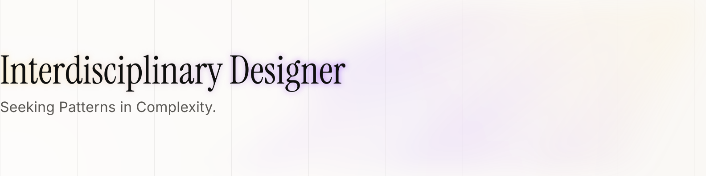

<picture>
  <source media="(prefers-color-scheme: dark)" srcset="assets/banner-dark.svg">
  
</picture>

 

I work where design, code, AI, and complex systems overlap — making hard things feel simple to use.

I started in engineering, moved into design, and now spend most of my time in the space between the two: prototyping with code, building small tools, and figuring out how AI changes the way interfaces get made. Currently designing products at Pixeldust, based in Mumbai.

 

<picture>
  <source media="(prefers-color-scheme: dark)" srcset="assets/label-working-with-dark.svg">
  
</picture>

&nbsp;&nbsp;&nbsp;&nbsp;&nbsp;&nbsp;&nbsp;&nbsp;

TypeScript / React — learning in public.

 

<picture>
  <source media="(prefers-color-scheme: dark)" srcset="assets/label-writing-dark.svg">
  
</picture>

[The Hardest Part Wasn't Animation. It Was Getting Started.](https://medium.com/@shreyasbhosle89/the-hardest-part-wasnt-animation-it-was-getting-started-d3dd68901462) — on how Figma Motion removed the friction of getting started.

 

<picture>
  <source media="(prefers-color-scheme: dark)" srcset="assets/label-find-me-dark.svg">
  
</picture>

&nbsp;&nbsp;&nbsp;&nbsp;&nbsp;&nbsp;&nbsp;&nbsp;

<!--
Projects section — add here once repos are public. Generate a matching
label with scripts/build.py (label("Building", theme)) and drop it in like
the others. See scripts/README.md for how to run it.

<picture>
  <source media="(prefers-color-scheme: dark)" srcset="assets/label-building-dark.svg">
  
</picture>

| Project | What it is | Stack |
| --- | --- | --- |
| [name](repo-link) | one line on what it does | · |
-->
